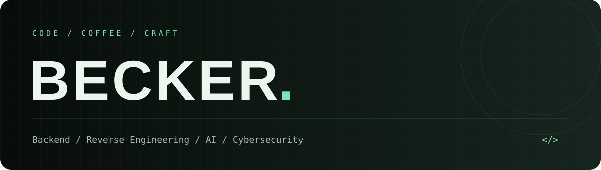
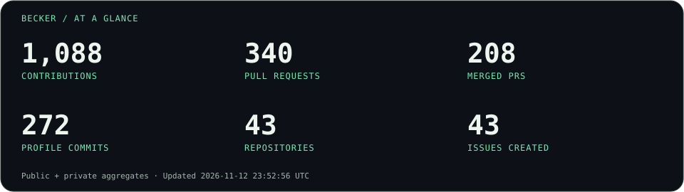
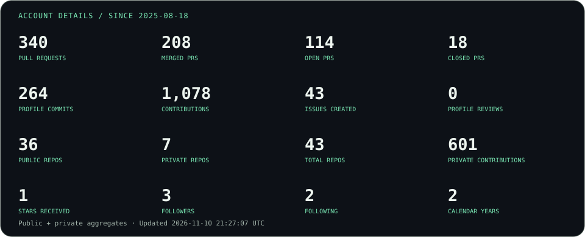
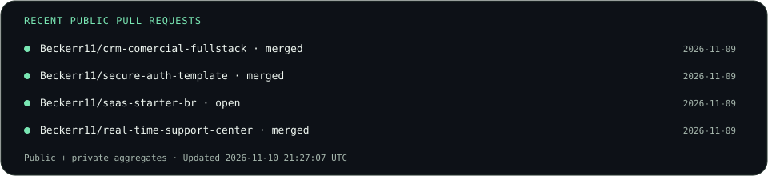

<div align="center">



### Backend · Reverse Engineering · Artificial Intelligence · Cybersecurity

`[ BUILDING ]` &nbsp; ` [ EXPLORING ] ` &nbsp; `[ REFINING ]`

</div>

---

## `$ whoami`

```text
alias      Becker
build      Backends · APIs · Developer tools
explore    Reverse engineering · Software analysis · AI
interests  Cybersecurity · Application security
mindset    Understand. Build. Refine.
```

I work on backends, reverse engineering, and AI applications. I enjoy understanding how software works beneath the surface, investigating its behavior, and turning that knowledge into useful tools and automation.

My interests also include cybersecurity, application security, and the connection between building software and understanding its internals.

---

## `$ cat focus.txt`

```text
[ Backend ]              APIs · Data persistence · Integrations · Testing
[ Reverse Engineering ]  Software behavior · File formats · Tooling
[ AI & Automation ]      AI applications · Workflow automation
[ Cybersecurity ]        Application security · Software analysis
```

## `$ ls languages/`

<p align="center">

</p>

<p align="center"><sub>Python · TypeScript · JavaScript · C# · C++</sub></p>

---

## `$ ls projects/`

| Project | Focus |
| :--- | :--- |
| [URL Shortener API](https://github.com/Beckerr11/url-shortener-api) | HTTP backend, URL shortening, and testing |
| [Client Portal Pro](https://github.com/Beckerr11/client-portal-pro) | React interface and Node.js API |
| [GitHub Security Automation](https://github.com/Beckerr11/github-security-automation) | Python, GitHub API, and automation |
| [Fullstack E2E Blueprint](https://github.com/Beckerr11/fullstack-e2e-blueprint) | HTTP contracts and end-to-end testing |

<p align="center"><a href="https://github.com/Beckerr11?tab=repositories">Explore repositories →</a></p>

---

## `$ github --stats`



<details>
<summary>More stats & data coverage</summary>



Account totals are collected directly from the GitHub API, including accessible private activity as aggregate counts only. Commit and contribution counts follow GitHub profile attribution rules; they do not represent every commit on every branch.

GitHub Actions checks for updates every 5 minutes, even when my computer is offline. Workflow queues and image caching may delay updates. Each card shows the collection timestamp. [Full dataset](assets/metrics.json).

</details>

## `$ github --activity`



---

<div align="center">

`understand the system. build something better.`

<sub>BECKER / code, coffee, craft.</sub>

</div>
